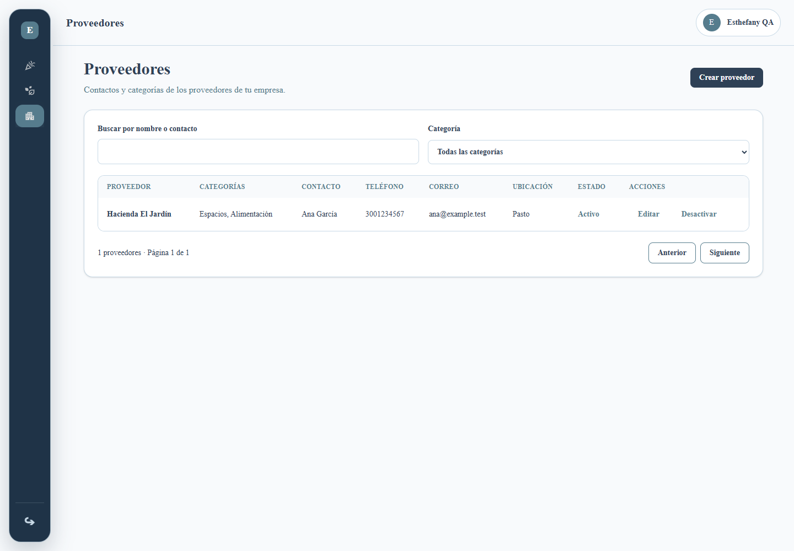
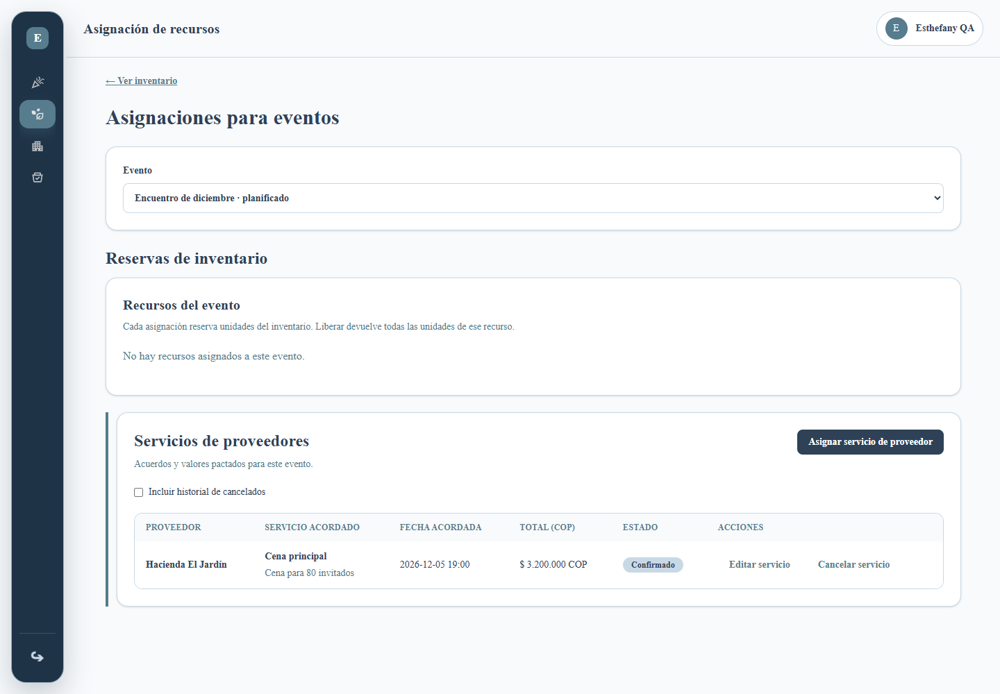
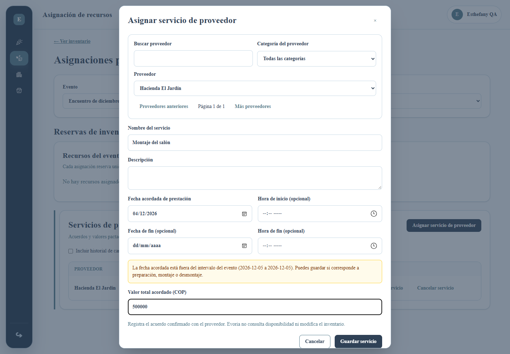
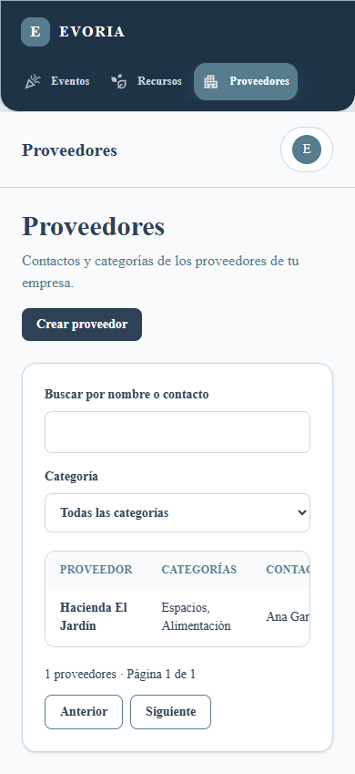
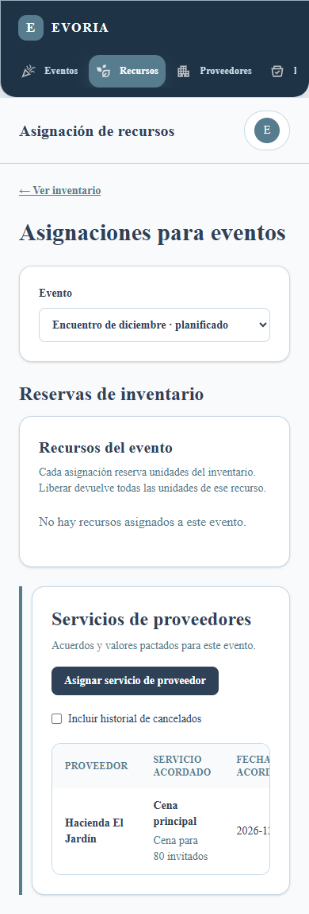

# Interfaz de proveedores y servicios

Implementada sobre el backend del PR #54, siguiendo `propuesta-proveedores-y-servicios.md` y los contratos compartidos. No cambia el backend ni los formularios, validaciones o componentes de Eventos.

## Pantallas

- `/proveedores`: directorio con búsqueda por nombre o contacto, filtro por categoría, paginación, creación y edición en diálogo, desactivación confirmada y estados de carga, vacío y error.
- `/recursos/asignaciones`: mantiene el selector de evento y las reservas de inventario. Añade una sección independiente de acuerdos de servicios con total en COP, fechas de calendario, edición, cancelación confirmada e historial. Guardar o cancelar un acuerdo refresca solamente los servicios.
- Los formularios conservan sus valores si falla una operación y muestran validaciones junto a los campos. Una fecha fuera del intervalo del evento genera una advertencia que permite guardar.
- Los proveedores inactivos permanecen en acuerdos históricos y pueden conservarse al editar esos acuerdos; el selector consulta únicamente proveedores activos. Se permiten varios acuerdos del mismo proveedor por evento.

## Acceso

El directorio requiere `proveedores.ver`; sus acciones usan los permisos `.crear`, `.editar` y `.desactivar`. La navegación, el acceso directo y la ruta predeterminada de Asignaciones admiten `asignaciones.ver` **o** `servicios_proveedor.ver`. Cada sección consulta su propia API solo si tiene su permiso de lectura.

Los acuerdos usan `servicios_proveedor.crear/editar/cancelar`; crear exige además `proveedores.ver`. Editar un acuerdo sin consultar proveedores permite corregir sus datos conservando el proveedor actual. Sin `eventos.ver` se explica que no puede cargarse el selector y no se consulta `/events`. En un evento cancelado solo se permite consultar y cancelar acuerdos existentes.

## Verificación reproducible

Desde la raíz, con dependencias instaladas:

```sh
npm run format:check
npm run lint
npm run typecheck
npm run build
npx playwright install chromium
npm run test:providers:e2e --workspace=@evoria/web
npm run test:providers --workspace=@evoria/api
```

La suite de interfaz utiliza el build standalone en el puerto 3100. Requiere ese puerto libre. También admite un navegador instalado mediante `E2E_BROWSER_CHANNEL=msedge` (en PowerShell: `$env:E2E_BROWSER_CHANNEL='msedge'`). No debe ejecutarse un nuevo build mientras el servidor de pruebas siga activo.

Son 12 escenarios ejecutados en escritorio y móvil (24 pruebas), con respuestas API simuladas, sin escribir en una base de datos. Cubren creación, filtros y paginación, edición, errores recuperables, cancelaciones e historial, fechas sin conversión UTC, monto y fin, proveedor inactivo, evento cancelado, permisos independientes, protección de rutas, ausencia de sesión y bloqueo del cierre durante un guardado. Verifican también que guardar servicios no recargue eventos ni reservas de inventario. Las seis pruebas de servicios del backend existente se ejecutan por separado.

## Capturas

Las capturas usan datos ficticios de la suite, con los componentes y estilos existentes.











## Puesta en marcha y límites

- En bases existentes, un responsable debe ejecutar `npm run seed:access-control`, como indica el PR #54, para registrar los permisos. Esta implementación no ejecuta semillas ni cambia usuarios o perfiles de una base compartida.
- Las pruebas de navegador simulan el contrato HTTP; no sustituyen la integración contra una API y MongoDB aisladas. No se ejecutó esa integración con credenciales reales durante esta entrega.
- Las fechas de prestación se envían y muestran como `YYYY-MM-DD`, y las horas como `HH:mm`. El intervalo del evento, que llega como instantes, se compara en horario de Colombia (`America/Bogota`).
- Se conserva el alcance de la propuesta: no hay consulta de disponibilidad, pagos ni incorporación automática del monto a Presupuestos.
